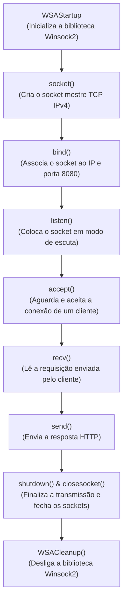

# WindowsSocket_in_C

Um mini projeto para aprender a criar um servidor local usando o conceito de sockets de rede na linguagem C para o sistema operacional Windows (via API **Winsock2**).

De início, o servidor escuta requisições locais e envia uma resposta HTTP simples. O objetivo futuro é expandir o projeto até que seja possível jogar o clássico jogo da velha (*ou melhor, dos mais experientes xD*) em modo multiplayer via rede.

---

## 📌 Sumário

- [Visão Geral e Conceitos](#-visão-geral-e-conceitos)
- [Ciclo de Vida do Servidor Winsock](#-ciclo-de-vida-do-servidor-winsock)
- [Pré-requisitos](#-pré-requisitos)
- [Compilação](#-compilação)
- [Execução e Testes](#-execução-e-testes)
- [Estrutura do Repositório](#-estrutura-do-repositório)
- [Próximos Passos (Roadmap)](#-próximos-passos-roadmap)
- [Licença](#-licença)

---

## 💡 Visão Geral e Conceitos

Sockets funcionam de forma análoga a uma ligação telefônica: um lado inicia a chamada, aguarda a conexão, troca mensagens (conversa) e, ao final, encerra a ligação.

No modelo de rede do projeto:
- **Camada de Transporte (TCP/IP):** Gerenciada pelos sockets (`socket`, `bind`, `listen`, `accept`). O protocolo TCP garante uma entrega confiável e ordenada de pacotes.
- **Camada de Aplicação (HTTP):** O conteúdo transmitido (`HTTP/1.1 200 OK ...`), permitindo testar o servidor tanto por utilitários de terminal (`curl`) quanto diretamente em navegadores web.
- **Network Byte Order:** A porta (8080) é convertida para o formato de rede através da função `htons()` (Big Endian), padrão necessário para comunicações em rede.

---

## 🔄 Ciclo de Vida do Servidor Winsock



---

## 💻 Pré-requisitos

- Sistema Operacional: **Windows** (10 ou 11)
- Compilador C:
  - **MinGW-w64** (`gcc`) **ou**
  - **Microsoft Visual C++** (`cl` / MSVC Build Tools)

---

## ⚙️ Compilação

Abra o terminal (PowerShell, CMD ou terminal do VS Code) no diretório do projeto:

### Opção 1: Usando MinGW (GCC)

Como a biblioteca física do Winsock (`ws2_32`) precisa ser vinculada durante a compilação no GCC, utilize a flag `-lws2_32`:

```powershell
gcc servidor.c -o servidor.exe -lws2_32
```

### Opção 2: Usando MSVC (cl)

No prompt de comando de desenvolvedor do Visual Studio (*Developer Command Prompt*), o código utiliza a diretiva `#pragma comment(lib, "ws2_32.lib")` para vincular automaticamente a biblioteca:

```cmd
cl servidor.c
```

---

## 🚀 Execução e Testes

### 1. Iniciar o servidor

No primeiro terminal, execute o binário gerado:

```powershell
.\servidor.exe
```

Saída esperada:
```text
Ambiente Inicializado
Socket criado
Bind feito!
Servidor iniciado. Aguardando conexao na porta 8080...
```

### 2. Testar a conexão

Em um segundo terminal, use o `curl` para disparar uma requisição:

```powershell
curl http://localhost:8080
```

Ou abra seu navegador de preferência e acerte a URL:
```text
http://localhost:8080
```

Saída no cliente:
```text
Ola! voce se conectou.
```

Saída atualizada no servidor:
```text
Novo socket criado!
Pedido recebido do cliente (XX bytes)!
Mensagem enviada com sucesso. 91 bytes transferidos :)
```

---

## 📂 Estrutura do Repositório

```text
WindowsSocket_in_C/
├── .gitignore     # Regras para ignorar binários, artefatos de build (VS, MinGW) e temporários
├── LICENSE        # Licença MIT
├── README.md      # Documentação do projeto, compilação e execução
└── servidor.c     # Código-fonte didático em C com a implementação do servidor Winsock
```

---

## 🎯 Próximos Passos (Roadmap)

- [x] Servidor básico TCP aceitando uma conexão e respondendo via HTTP simples.
- [ ] Loop contínuo para aceitar múltiplas requisições sequenciais.
- [ ] Suporte a múltiplos clientes simultâneos (via threads ou `select`/`poll`).
- [ ] Implementação de um protocolo de jogo e lógica do Jogo da Velha (Tic-Tac-Toe) via sockets.
- [ ] Criação do cliente de terminal (`cliente.c`) para interação entre jogadores.

---

## 📄 Licença

Este projeto está sob a licença [MIT](LICENSE). Consulte o arquivo `LICENSE` para mais detalhes.
